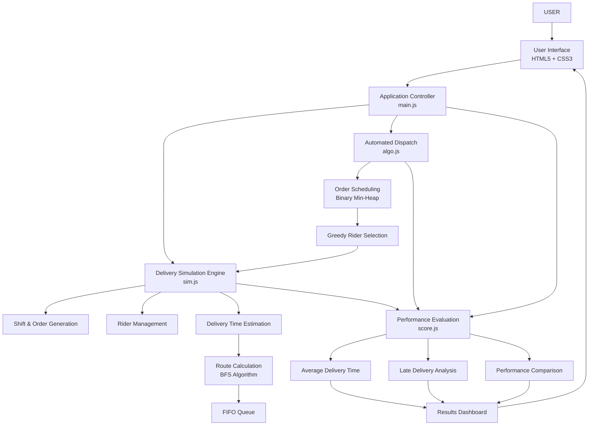

# 🚴 Delivery Rush – Smart Delivery Dispatch Simulator

An interactive delivery dispatch simulation system developed using HTML, CSS and JavaScript. The project demonstrates the application of graph algorithms, greedy scheduling and data structures to optimize delivery assignments in a simulated city environment.

## 📌 Project Overview

Delivery Rush simulates a city-based food delivery network consisting of restaurants, customer locations, delivery riders and restricted roads.

The system allows users to assign incoming delivery orders to four different riders and compare their decisions against an automated greedy dispatch algorithm.

The primary objective is to minimize average delivery time while managing multiple orders and road restrictions.

## 🏗️ System Architecture

The architecture of Delivery Rush consists of an interactive user interface, delivery simulation engine, route calculation module, automated dispatch algorithm and performance evaluation module.

### Block Diagram



### Architecture Components

| Component | Responsibility |
|---|---|
| User Interface | Displays the city grid, riders, orders and controls. |
| Application Controller | Handles user interactions, rendering and application flow. |
| Delivery Simulation Engine | Generates shifts, manages riders and calculates delivery times. |
| BFS Module | Calculates shortest paths through the city grid. |
| FIFO Queue | Supports BFS traversal. |
| Automated Dispatch | Assigns delivery orders using greedy scheduling. |
| Binary Min-Heap | Processes orders according to arrival time. |
| Performance Evaluation | Calculates average delivery time, late deliveries and performance results. |
| Results Dashboard | Displays the final comparison between manual and automated dispatch. |

### System Workflow

1. The user selects a delivery shift.
2. The simulation engine generates delivery orders and road restrictions.
3. BFS calculates the shortest available routes.
4. The user manually assigns orders to riders.
5. The automated dispatcher independently processes the same orders using a greedy scheduling algorithm.
6. Both approaches are evaluated using delivery-time metrics.
7. The final performance comparison is displayed.

## 🎯 Objectives

- Simulate a multi-rider delivery dispatch environment.
- Calculate shortest paths between locations.
- Optimize delivery assignments using greedy scheduling.
- Compare manual dispatch decisions with automated scheduling.
- Evaluate delivery performance using average delivery time.
- Analyze late deliveries and scheduling efficiency.

## ✨ Key Features

- **Interactive City Grid:** Visual representation of restaurants, homes, riders, buildings and bridges.
- **Three Delivery Shifts:** Lunch Rush, Rain Shift and Night Shift.
- **Four Delivery Riders:** Assign orders to Riders A, B, C and D.
- **Shortest Path Calculation:** Uses Breadth-First Search.
- **Automated Dispatch Algorithm:** Selects the rider with the earliest expected delivery completion time.
- **Delivery Time Estimation:** Displays estimated delivery time for each rider.
- **Undo Functionality:** Reverses the previous rider assignment.
- **Performance Comparison:** Compares manual dispatch performance against the automated algorithm.
- **Late Delivery Analysis:** Tracks deliveries exceeding 20 minutes.
- **Challenge Mode:** Generates a shareable challenge link based on delivery performance.
- **Keyboard Shortcuts:** Supports keyboard-based rider selection.
- **Light and Dark Themes:** Allows users to switch between visual themes.

## 🌆 Delivery Scenarios

The simulation consists of three different shifts with varying delivery volumes and bridge accessibility.

| Delivery Shift | Number of Orders | Open Bridges |
|---|---:|---:|
| Lunch Rush | 12 | 3 |
| Rain Shift | 14 | 2 |
| Night Shift | 16 | 1 |
| **Total** | **42** | — |

Each scenario introduces different road restrictions, affecting delivery routes and rider scheduling decisions.

## 🧠 Algorithms and Data Structures

### 1. Breadth-First Search (BFS)
Used to calculate the shortest path from a starting location to other reachable cells in the city grid.

### 2. Greedy Scheduling Algorithm
Evaluates available riders and assigns each incoming order to the rider with the earliest expected delivery completion time.

### 3. Binary Min-Heap
Maintains incoming delivery orders according to their arrival times.

### 4. FIFO Queue
Used during BFS traversal to process grid locations in the correct order.

### 5. Memoization
Stores previously calculated distance maps to avoid unnecessary repeated BFS computations.

## 📊 Performance Evaluation

After completing a delivery shift, the system compares the user's dispatch decisions against the automated algorithm.

Performance metrics include:

- Average delivery time.
- Automated algorithm's average delivery time.
- Number of late deliveries.
- Three largest delivery-time differences.

### Performance Classification

| Result | Condition |
|---|---|
| Win | Manual average delivery time is lower than the algorithm. |
| Close | Manual average is within 10% of the algorithm. |
| Behind | Manual average is more than 10% slower than the algorithm. |

A delivery is classified as late when its delivery time exceeds 20 minutes.

## 🛠️ Technologies Used

| Technology | Application |
|---|---|
| HTML5 | Application structure |
| CSS3 | Styling and responsive layout |
| JavaScript (ES6 Modules) | Simulation logic and algorithm implementation |
| SVG | City grid visualization |
| LocalStorage | Theme preference persistence |

## 📂 Project Structure

```text
delivery-rush/
│
├── index.html
│
├── css/
│   └── tokens.css
│
└── js/
    ├── main.js
    │
    └── engine/
        ├── algo.js
        ├── bfs.js
        ├── heap.js
        ├── queue.js
        ├── score.js
        └── sim.js
```
## 🚀 Future Scope

- Integration with real-world maps.
- Dynamic traffic and congestion simulation.
- Advanced route optimization algorithms.
- Real-time rider tracking.
- Backend and database integration.
- Expanded delivery networks.
- Advanced delivery analytics.

## 🎓 Learning Outcomes

This project demonstrates practical implementation and understanding of:

- Graph traversal algorithms.
- Shortest-path computation.
- Greedy optimization techniques.
- Binary Min-Heap implementation.
- FIFO Queue implementation.
- Memoization.
- JavaScript modular programming.
- Interactive frontend development.
- Algorithm performance evaluation.

## 👩‍💻 Project Details

**Project Name:** Delivery Rush

**Project Category:** Web Development | Algorithm Design | Simulation

**Frontend:** HTML5, CSS3, JavaScript

**Core Concepts:** BFS, Greedy Scheduling, Binary Min-Heap, FIFO Queue and Memoization

**Project Focus:** Smart Delivery Dispatch and Scheduling Optimization      

give block diagram architceturee..!!!!!
